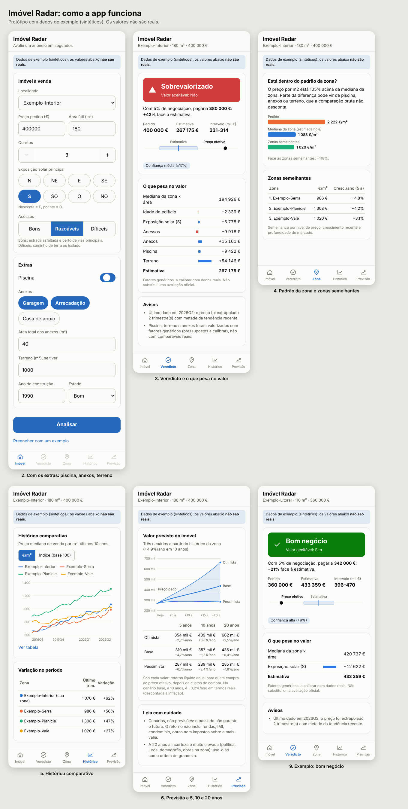

# Imóvel Radar

Indica-se um imóvel à venda (localidade, preço, área, quartos, exposição solar, acessos, piscina, anexos, terreno) e a app responde:

1. **Estimativa indicativa** do valor, com intervalo e nível de confiança.
2. **Veredicto** sobre o preço: *Sobrevalorizado*, *Aceitável*, *Bom negócio*, *Pechincha* ou *Inconclusivo*, e se o valor é aceitável ou não.
3. **Padrão da zona:** o preço por m² está dentro do padrão da zona e de zonas semelhantes?
4. **Histórico comparativo** da zona face às zonas semelhantes.
5. **Previsão de valor a 5, 10 e 20 anos** em três cenários, com o retorno líquido de custos de compra.
6. **O que pesa no valor:** contributo em € de idade, estado, exposição, acessos, anexos, piscina e terreno.

> **Aviso.** É uma estimativa estatística, não uma avaliação oficial (que cabe a um perito avaliador) nem aconselhamento financeiro. Os dados incluídos são **sintéticos**: os números de exemplo e as imagens não são reais.



Todas as imagens estão em [`docs/ecras/`](docs/ecras/) (formulário, veredicto, zona, histórico, previsão, modo escuro).

## Como correr

Só precisa de Python 3.10+ (sem dependências para o modo base).

**App mobile (web)**

```bash
python3 -m imovel_radar.server --porta 8000
```

Abra `http://127.0.0.1:8000` no browser (em modo telemóvel) ou, na mesma rede Wi-Fi, use `--host 0.0.0.0` e abra o endereço do computador no telemóvel. A app não tem autenticação: não a exponha à internet.

**Linha de comandos**

```bash
python3 -m imovel_radar examples/anuncio_exemplo.json --data 2026-11-01
python3 -m imovel_radar examples/anuncio_exemplo.json --config examples/config_exemplo.json
python3 -m unittest discover -s tests -t .
```

Opções: `--dados` (CSV de preços), `--data` (data de referência), `--config` (pressupostos em JSON), `--com-ia`, `--json`.

**Regenerar as imagens** (requer Node e Playwright): `node scripts/capturar_ecras.js`.

## Anúncio (JSON ou formulário)

Obrigatórios: `concelho` (localidade), `preco_pedido`, `area_util_m2`. Opcionais:

| Campo | Valores |
|---|---|
| `quartos` | número inteiro (gera um aviso se for incoerente com a área) |
| `exposicao_solar` | `N`, `NE`, `E`, `SE`, `S`, `SO`, `O`, `NO` (ou norte, sul, nascente, poente…) |
| `acesso` | `bom`, `razoavel`, `dificil` |
| `estado` | `novo`, `renovado`, `bom`, `razoavel`, `para_recuperar` |
| `extras` | lista, por exemplo `["piscina"]` |
| `anexos`, `area_anexos_m2` | lista e área total; sem área, os anexos ficam sinalizados e fora da estimativa |
| `area_terreno_m2`, `ano_construcao`, `descricao`, `fotos`, `titulo` | |

O anúncio é fornecido por quem usa a app. **Não há *scraping* de portais**: ver "Fonte dos anúncios".

## Como funciona

**Estimativa.** Preço mediano por m² do concelho (último trimestre, extrapolado até 4 trimestres com metade da tendência) × área útil × fatores de idade, estado, exposição, acessos e apreciação. Somam-se anexos, piscina e terreno. Estes três usam fatores genéricos (pressupostos), ou valores absolutos se os definir na configuração, e se ficarem sem valor ficam **sinalizados como não valorizados**.

**Intervalo e confiança.** Cresce quando há poucas transações na zona e quando há componentes estimados por fator ou em falta.

**Veredicto.** Compara o *preço efetivo* (pedido menos a margem de negociação, 5% por omissão, porque os dados medem vendas e os anúncios mostram pedidos) com a estimativa. Se o preço parece alto mas há componentes não valorizados, o resultado é *Inconclusivo*, não *Sobrevalorizado*. A diferença só é "significativa" se exceder a margem de incerteza. Uma *Pechincha* vem sempre com um aviso de cautela.

**Padrão da zona e zonas semelhantes.** Compara o €/m² pedido com a mediana da zona e das zonas semelhantes (parecidas em nível de preço, crescimento a 5 anos e profundidade de mercado). É uma comparação bruta: não desconta piscina, terreno nem anexos.

**Projeção.** Parte do crescimento histórico anual da zona e converge para um crescimento de longo prazo (2% por omissão). Os cenários deslocam o crescimento em ±meio desvio-padrão histórico. O retorno desconta custos de compra e inflação. Não inclui rendas, IMI, condomínio, obras nem mais-valias. A 20 anos a incerteza é muito elevada. Se a estimativa ignora componentes, o retorno é omitido, porque seria enganador.

## Pressupostos que tem de rever

Estes valores são pontos de partida, **não vêm de fonte oficial**: margem de negociação, custos de compra (7%), fatores de estado, idade, exposição e acesso, peso da piscina (5% da casa), do terreno (5% do €/m² da casa) e dos anexos (35% do €/m²), limites do veredicto, crescimento de longo prazo e inflação. Todos se alteram num JSON de configuração (`Config` em `imovel_radar/config.py`); os valores de `examples/config_exemplo.json` são ilustrativos.

## Dados

`data/sample/preco_m2_concelho_SINTETICO.csv` é **fictício**, gerado por `scripts/gerar_dados_sinteticos.py`, com 8 concelhos de nome "Exemplo-…". Para usar dados reais, crie um CSV com as colunas

```
concelho,trimestre,preco_m2_mediano,n_transacoes,fonte
```

a partir das estatísticas de preços da habitação do INE (preço mediano de venda por m² e número de transações, por município e trimestre) e passe-o com `--dados`. Confirme no site do INE os nomes exatos dos indicadores e as condições de reutilização. O INE publica agregados, não vendas individuais, e com atraso, por isso a mediana municipal esconde diferenças entre bairros e entre tipos de imóvel.

## Análise com IA (`--com-ia`)

```bash
pip install anthropic
export ANTHROPIC_API_KEY=...        # chave da API
export IMOVEL_RADAR_MODEL=...       # modelo a usar
python3 -m imovel_radar anuncio.json --com-ia
```

Envia as fotos (até 6) e a descrição para o modelo, que devolve nota, resumo e pontos positivos e negativos. As fotos saem da sua máquina para a API: não use imagens com dados pessoais. Sem `--com-ia`, a nota vem de uma heurística por palavras-chave da descrição. Esta parte foi testada com um cliente simulado, não contra a API real, e a app mobile ainda não envia fotos.

## Fonte dos anúncios

O MVP não faz *scraping*: os termos de uso de muitos portais proíbem a extração automática, há direitos sobre bases de dados e fotos, e podem existir dados pessoais nos anúncios (RGPD). O caminho mais seguro para um produto é uma API oficial ou uma parceria. A fonte está isolada (`Anuncio.de_dict`), por isso pode ser substituída sem mexer no modelo.

## Estado e próximos passos

A app é uma web app mobile-first ligada à API local, não uma app nativa. Falta:

- Descarga de dados reais do INE e calibração da margem de negociação e dos fatores.
- Zonas mais finas do que o concelho (freguesia) e avaliação bancária como segunda âncora.
- Envio de fotos a partir do telemóvel e guardar análises/favoritos.
- Empacotar como app nativa ou PWA instalável, com contas e alojamento.
